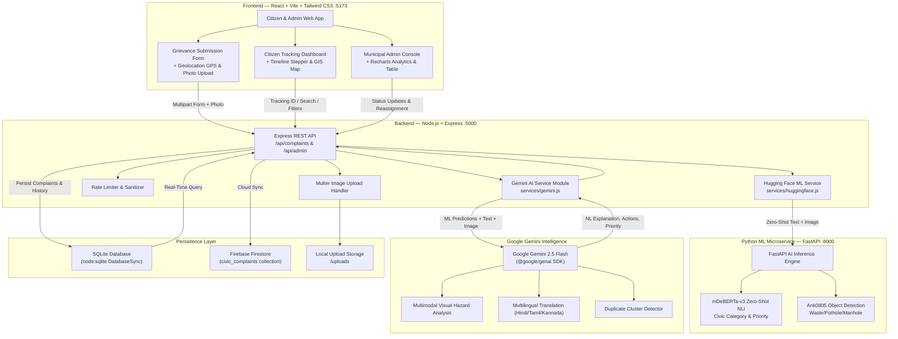

# 🏛️ CivicResolve — AI-Powered Civic Grievance & Resolution Platform

> **"Report. Track. Resolve."**  
> An intelligent full-stack civic technology platform connecting citizens directly with municipal corporations. Powered by Google Gemini 2.5 Flash to automatically classify complaints, calculate public hazard priority, route to municipal departments, and deliver real-time resolution transparency.

---

## 🌟 Executive Summary & Problem Solved

Citizens frequently encounter acute civic hazards—deep road craters, overflowing biological waste, live dangling electrical cables, broken streetlights, and ruptured drinking water pipelines. Traditional municipal complaint portals are notoriously slow, confusing, and opaque:
1. **Misclassification**: Citizens often don't know whether to notify PWD, BBMP/BMC, the Electricity Board, or the Water Authority.
2. **Prioritization Paralysis**: Critical life hazards (e.g. 440V sparking wires near school gates) get lost in massive queues behind routine requests.
3. **Black-Hole Tracking**: Citizens file grievances and receive zero updates on who is handling it or when it will be fixed.

**CivicResolve** solves this using **Google Gemini multimodal intelligence**:
- 📸 **Multimodal Vision & NLP**: Citizens report issues via text and photo evidence in English, Hindi, or Tamil.
- ⚡ **Automated AI Triage**: Gemini parses severity, public footfall, and road sensitivity to determine Priority (**Critical, High, Medium, Low**), recommends the exact operating department, and outputs structured JSON.
- 🔄 **Duplicate Cluster Detection**: Flags and merges repeated submissions for the same localized incident.
- 📍 **GIS Map & Stepper**: Real-time 3-step transparent tracking timeline (**Reported → In Progress → Resolved**) plus interactive Leaflet GIS map.
- 🛡️ **Municipal Operations Dashboard**: Live analytics with Recharts, status transitions, department reassignment, and formal grievance letter generation.

---

## 🏗️ System Architecture



---

## 🚀 Tech Stack

| Layer | Technologies |
| :--- | :--- |
| **Frontend** | React 18, Vite, Tailwind CSS, Lucide React, Recharts, Leaflet & React-Leaflet, Canvas-Confetti |
| **Backend & APIs** | Node.js, Express, Multer, dotenv, CORS, UUID + **FastAPI Python ML Microservice** |
| **Machine Learning** | **`MoritzLaurer/mDeBERTa-v3-base-mnli-xnli`** (zero-shot NLI civic classification & priority) |
| **Vision AI** | **`Ank0805/waste-pothole-manhole-detection`** (visual hazard & pothole detection) |
| **Generative AI** | **Google Gemini 2.5 Flash** via `@google/genai` (multilingual translation, ML explanation, action planning, formal notice drafting) |
| **Database** | **SQLite** (`node:sqlite` DatabaseSync) & **Firebase Firestore** (`civic_complaints` collection) dual-layer persistence |
| **Security** | Hugging Face & Gemini API keys strictly kept on backend; input sanitization, file limits, rate limiting |

---

## ⚡ Quick Start & Setup

### Prerequisites
- **Node.js** v20+ or v22+ (tested and verified on Node v26)
- **npm** v10+
- **Python** 3.10+ (for the FastAPI ML microservice — tested on Python 3.14)
- **pip packages**: `fastapi uvicorn requests pydantic python-dotenv python-multipart google-genai firebase-admin`

### 1. Clone & Install Dependencies
```bash
# Clone the repository
git clone <repo-url>
cd CivicResolve

# Install root, server, and client packages
npm run install:all

# Install Python dependencies
pip install fastapi uvicorn requests pydantic python-dotenv python-multipart google-genai firebase-admin
```

### 2. Configure Environment Variables
Copy `.env.example` to `.env` in the root (and in `server/.env`):
```bash
cp .env.example .env
```

Edit `.env`:
```env
PORT=5000

# Hugging Face Inference API
HF_TOKEN=your_huggingface_token_here
HF_TEXT_MODEL=MoritzLaurer/mDeBERTa-v3-base-mnli-xnli
HF_IMAGE_MODEL=Ank0805/waste-pothole-manhole-detection

# FastAPI Python Microservice URL
FASTAPI_URL=http://localhost:8000

# Google Gemini API Key (Get yours from https://aistudio.google.com/)
# Note: If no key is set, CivicResolve automatically activates its built-in
# Intelligent Heuristic Municipal Analyst so all features remain 100% demoable!
GEMINI_API_KEY=your_gemini_api_key_here
GEMINI_MODEL=gemini-2.5-flash

# Firebase Firestore (Optional - runs with local SQLite if not configured)
FIREBASE_PROJECT_ID=civicresolve-prod

# Municipal Admin Demo Credentials
ADMIN_USER=admin
ADMIN_PASS=civicadmin123
```

### 3. Run All Three Services (Single Command!)
```bash
npm run dev
```
This starts **all three** services concurrently with color-coded logs:
- 🟡 **[FASTAPI]** Python ML Microservice → `http://localhost:8000`
- 🔵 **[SERVER]** Node.js Express API → `http://localhost:5000`
- 🟣 **[CLIENT]** Vite React Frontend → `http://localhost:5173`

> **Alternative**: To run without the Python service, use `npm run dev:no-py` (falls back to Node.js ML heuristics).

### 4. (Optional) Run the Comprehensive Test Suite
```bash
node test-e2e.js
```
Runs 34 automated integration tests across API health, grievance submission, Gemini classification, tracking, upvoting, admin analytics, and live history stepper updates.

---

## 📋 Core Features Walkthrough

### 1. Citizen Issue Reporting & Live Hazard Scanner (`/report`)
- **Live AI Camera (WebRTC `getUserMedia`)**:
  - Point device camera at potholes, overflowing garbage, or open drains with real-time video stream HUD.
  - Mobile rear-camera support with auto-switch (`facingMode: { ideal: "environment" }`) and toggle switch lens button.
  - Periodic live frame inspection (every 2.5s) rendering real-time bounding boxes directly over the video stream without incurring Gemini API costs.
  - "Capture & Inspect Hazard" button captures full-resolution snapshot.
- **Drag-and-Drop File Upload**:
  - Drag and drop zone supporting JPG, PNG, and WebP (up to 10MB).
- **YOLO11 & Ank0805 Hazard Detection**:
  - Locates bounding boxes, detected civic hazard labels, and confidence scores.
- **Multimodal Gemini Vision Assessment**:
  - Analyzes the physical defect, identifies danger to pedestrians and two-wheelers, and formulates engineering remediation actions.
- **Transparent Severity & Urgency Scoring**:
  - Score (0-100) calculated from Safety Risk (40 pts) + Public Exposure (30 pts) + Infrastructure Sensitivity (20 pts) + Area Scale (10 pts).
- **Citizen Confirmation & Correction Panel**:
  - Citizens review detected hazards, bounding boxes, suggested department, and can manually adjust category/priority before final submission.
- **GPS One-Click Geolocation**: "Use My Current Location" button queries the browser's Geolocation API to auto-fill exact coordinates.
- **Multilingual Support**: Accepts complaints in **Tamil, Hindi, Kannada, or English**. Gemini automatically detects the source language and provides clean English translations.
- **Live AI Analyzing Animation**: Shows animated progress steps ("Parsing text...", "Inspecting multimodal visual evidence...", "Evaluating public danger risk...", "Assigning municipal department...").
- **Success Screen & Confetti**: Confetti burst with a one-click copyable Tracking ID (e.g., `CR-892B14`) and immediate AI evaluation card.

### 2. AI-Powered Classification & Priority Detection (Gemini 2.5 Flash)
- Returns structured JSON validated via Gemini JSON schema:
  ```json
  {
    "category": "Roads | Sanitation | Street Lighting | Water Supply | Drainage | Public Safety | Parks | Other",
    "priority": "Low | Medium | High | Critical",
    "priority_reason": "1-2 sentence justification based on urgency and public impact",
    "recommended_department": "Name of municipal body, e.g. Public Works Department, Electricity Board",
    "summary": "One-line clean executive summary of the issue",
    "estimated_resolution_time": "e.g., 24-48 hours",
    "confidence": 98
  }
  ```
- **Urgency Matrix**: Priority is calculated from immediate physical safety hazard (live electric wires, deep open manholes = **Critical**), health epidemiology (overflowing bio-waste = **High**), transit impedance = **Medium**, routine cosmetic asset repairs = **Low**.

### 3. Citizen Issue Tracking Dashboard (`/track`)
- **Search & Filters**: Search by tracking ID, keyword, or filter by Status, Category, Priority, and Sort order.
- **View Toggle**: Switch between **Grid Cards** and compact **List View**.
- **Interactive GIS Map**: Click "Map View" to open a full-screen Leaflet OpenStreetMap with pins color-coded by priority (🔴 Critical, 🟠 High, 🟡 Medium, 🟢 Low) and clickable popups.
- **3-Step Resolution Stepper**: Visual stepper tracking: **Reported → In Progress → Resolved** with date-stamped action log.
- **"I'm Affected Too" Upvote Button**: Citizens upvote existing issues to signal high community impact.
- **Formal Escalation Notice Generator**: Generates an official, legally structured formal grievance letter addressed to the Executive Engineer / Municipal Commissioner ready to copy or print.

### 4. Municipal Admin Console (`/admin`)
- **Secure Authentication**: Demo credentials (`admin` / `civicadmin123`) with a 1-click auto-fill button.
- **Live Metric KPI Cards**: Total grievances, Reported, In Progress, Resolved, and Critical Hazards.
- **Recharts Data Visualizations**:
  - Issues by Department / Category (Bar Chart)
  - Assessed Priority Breakdown (Color-coded Bar Chart)
  - Resolution Status Proportion (Donut / Pie Chart)
- **Table of Complaints**: Default-sorted by highest urgency first.
- **Operations Modal**:
  - Update status to *In Progress* or *Resolved*.
  - Reassign responsible department.
  - Add internal municipal remarks.
  - Add an action note that **instantly writes to the citizen's public timeline**.
  - Re-run Gemini AI assessment on demand.

---

## 🎬 60-90 Second Hackathon Demo Script

| Time | Action | What to Say / Show |
| :--- | :--- | :--- |
| **0:00 - 0:15** | Open Landing Page (`http://localhost:5173`) | *"This is CivicResolve: Report, Track, Resolve. An AI platform that eliminates bureaucratic delays in civic grievance management."* Point out the live municipal stats and the "Powered by Gemini 2.5 Flash" badge. |
| **0:15 - 0:35** | Click **"Report an Issue"** | Type: *"Snapped 440V live wire sparking outside school gate"*. Click **"Use My Current Location"** (GPS coordinates fill in). Keep category as *"✨ Auto-detect with AI"*. Click **"Submit & Analyze with Gemini"**. |
| **0:35 - 0:50** | Watch AI Analysis & Success Screen | Point out the real-time scanning steps. Confetti pops! Show the generated Tracking ID (e.g., `CR-WVZXWS`). Explain: *"Gemini visually inspected the danger, rated it Critical, identified the risk to schoolchildren, and assigned it to the Electricity Supply Board."* |
| **0:50 - 1:10** | Open **"Track Issue"** | Show the 3-step timeline stepper currently at *"Reported"*. Click *"I'm affected too"* (+1). Click *"Generate Formal Municipal Letter"* to show the auto-formatted official escalation letter ready for the Commissioner. Click *"Map View"* to show the geocoded GIS pins. |
| **1:10 - 1:30** | Switch to **"Admin Portal"** | Click *"Fill Demo Credentials"* & Sign in. Show the Recharts analytics (Category & Priority breakdown). Open the new complaint, update status to *"In Progress"*, and add note: *"Emergency Linemen Unit deployed with safety barricades"*. Click *"Save"*. |
| **1:30 - 1:40** | Return to **Citizen Tracking Page** | Refresh tracking view: the stepper is now at *"In Progress"* and the citizen immediately sees the Linemen Unit update in the audit log. Complete loop verified! |

---

## 🗄️ Database Schema (`complaints` table)

| Column | Type | Description |
| :--- | :--- | :--- |
| `id` | TEXT PRIMARY KEY | Unique UUID identifier |
| `trackingId` | TEXT UNIQUE | Short human-readable identifier (e.g. `CR-892B14`) |
| `title` | TEXT NOT NULL | Grievance headline |
| `description` | TEXT NOT NULL | Detailed description in any language |
| `location` | TEXT NOT NULL | Free-form address / GPS description |
| `lat`, `lng` | REAL | Geolocation coordinates |
| `imageUrl` | TEXT | Local URL to uploaded photographic evidence |
| `userCategory` | TEXT | Category selected by user or 'Auto-detect' |
| `aiCategory` | TEXT | Classified category from Gemini |
| `priority` | TEXT | `Critical` \| `High` \| `Medium` \| `Low` |
| `priorityReason` | TEXT | Justification based on public safety risk & footfall |
| `department` | TEXT | Recommended municipal department |
| `aiSummary` | TEXT | One-line executive summary |
| `geminiExplanation` | TEXT | Natural-language explanation synthesized by Gemini from ML predictions |
| `recommendedActions` | TEXT | Step-by-step municipal action plan generated by Gemini |
| `mlModel` | TEXT | Hugging Face model used (e.g. `MoritzLaurer/mDeBERTa-v3-base-mnli-xnli`) |
| `mlCategory` | TEXT | Zero-shot NLI category (e.g. `Road damage and potholes`) |
| `mlConfidence` | REAL | mDeBERTa zero-shot confidence score (0.0–1.0) |
| `mlAllPredictions` | TEXT (JSON) | Full ranked predictions array from zero-shot NLI |
| `mlPriority` | TEXT | ML-predicted priority (`Critical` / `High` / `Medium` / `Low`) |
| `mlPriorityConfidence` | REAL | Priority prediction confidence score |
| `imageDetections` | TEXT (JSON) | Ank0805 object detection results (waste/pothole/manhole bboxes) |
| `estimatedResolutionTime` | TEXT | Turnaround estimate (e.g. `24-48 hours`) |
| `confidence` | INTEGER | AI confidence percentage (0-100%) |
| `status` | TEXT | `Reported` \| `In Progress` \| `Resolved` |
| `adminNotes` | TEXT | Internal municipal remarks |
| `upvotes` | INTEGER | Citizen "I'm affected too" count |
| `isDuplicateOf` | TEXT | Linked parent tracking ID if duplicate detected |
| `detectedLanguage` | TEXT | Source language (`English`, `Hindi`, `Tamil`, etc.) |
| `englishTranslation` | TEXT | English translation of non-English complaints |
| `aiAnalysisPending` | INTEGER | Flag: `1` if ML/Gemini analysis is pending retry |
| `statusHistory` | TEXT (JSON) | Audit log array: `[{ status, timestamp, note, updatedBy }]` |
| `createdAt`, `updatedAt` | TEXT | ISO 8601 timestamps |

---

## 🛡️ Engineering Best Practices

1. **Security & Credential Isolation**: Gemini API key and Hugging Face tokens remain strictly server-side. The browser frontend never has access to any API key.
2. **Three-Tier AI Pipeline**: Complaints flow through **mDeBERTa zero-shot NLI → Ank0805 image detection → Gemini synthesis**. Each layer has independent fallbacks.
3. **Offline Fallback Architecture**: If `GEMINI_API_KEY` is not provided or Gemini encounters network throttling, CivicResolve gracefully switches to its built-in *Intelligent Heuristic Municipal Analyst*. If Hugging Face is unavailable, Node.js heuristics take over. The application never crashes or leaves the user stranded.
4. **Zero Native C++ Compilation**: By leveraging Node.js native `node:sqlite` (`DatabaseSync`), CivicResolve installs with zero node-gyp compilation failures on any operating system.
5. **Dual Persistence**: Complaints are saved to local SQLite (always available) and optionally synced to Firebase Firestore (`civic_complaints` collection) for cloud persistence.
6. **Rate Limiting & File Validation**: Express includes IP request rate limiting and Multer restricts file uploads to valid images under 8MB.
7. **Auditable Lifecycle**: Every status transition, department reassignment, or AI re-analysis is permanently timestamped and appended to the complaint's `statusHistory` JSON log.
8. **Confidence Transparency**: ML confidence scores are displayed with clear disclaimers that they indicate relative zero-shot ranking rather than guaranteed probabilities.

---

## 📂 Folder Structure

```
CivicResolve/
├── client/                      # React + Vite + Tailwind frontend
│   ├── src/
│   │   ├── components/          # Navbar, Footer, ComplaintCard, PriorityBadge, etc.
│   │   ├── pages/               # LandingPage, ReportIssuePage, TrackIssuePage, AdminDashboardPage
│   │   ├── api/                 # API client (fetchComplaints, adminLogin, etc.)
│   │   ├── App.jsx              # Root app with view routing & dark mode
│   │   └── index.css            # Tailwind directives
│   ├── public/uploads/          # Static seed images for dev
│   └── vite.config.js           # Vite + proxy config
├── server/                      # Node.js + Express backend
│   ├── database/
│   │   ├── db.js                # SQLite schema & helpers
│   │   ├── seed.js              # 14 realistic sample complaints
│   │   └── firestore.js         # Optional Firebase Firestore sync
│   ├── routes/
│   │   ├── complaints.js        # CRUD + ML + Gemini pipeline
│   │   └── admin.js             # Auth, stats, updates, re-analysis
│   ├── services/
│   │   ├── gemini.js            # Gemini AI classification & synthesis
│   │   └── huggingface.js       # mDeBERTa NLI + Ank0805 detection
│   └── uploads/                 # Uploaded grievance images
├── fastapi_service/             # Python FastAPI ML microservice
│   ├── main.py                  # Zero-shot NLI, image detection, Gemini synthesis
│   ├── run.py                   # Standalone runner
│   └── requirements.txt         # Python dependencies
├── scripts/
│   └── run-python.js            # Cross-platform Python launcher
├── .env                         # Environment variables (gitignored)
├── .env.example                 # Template for environment setup
├── package.json                 # Root scripts: dev, seed, install:all
├── test-e2e.js                  # 34-assertion integration test suite
└── README.md                    # This file
```

---

## 👥 Contributors & Hackathon Notes
- Built for the Hackathon with **Google Gemini 2.5 Flash**.
- Tagline: *"Report. Track. Resolve."*
